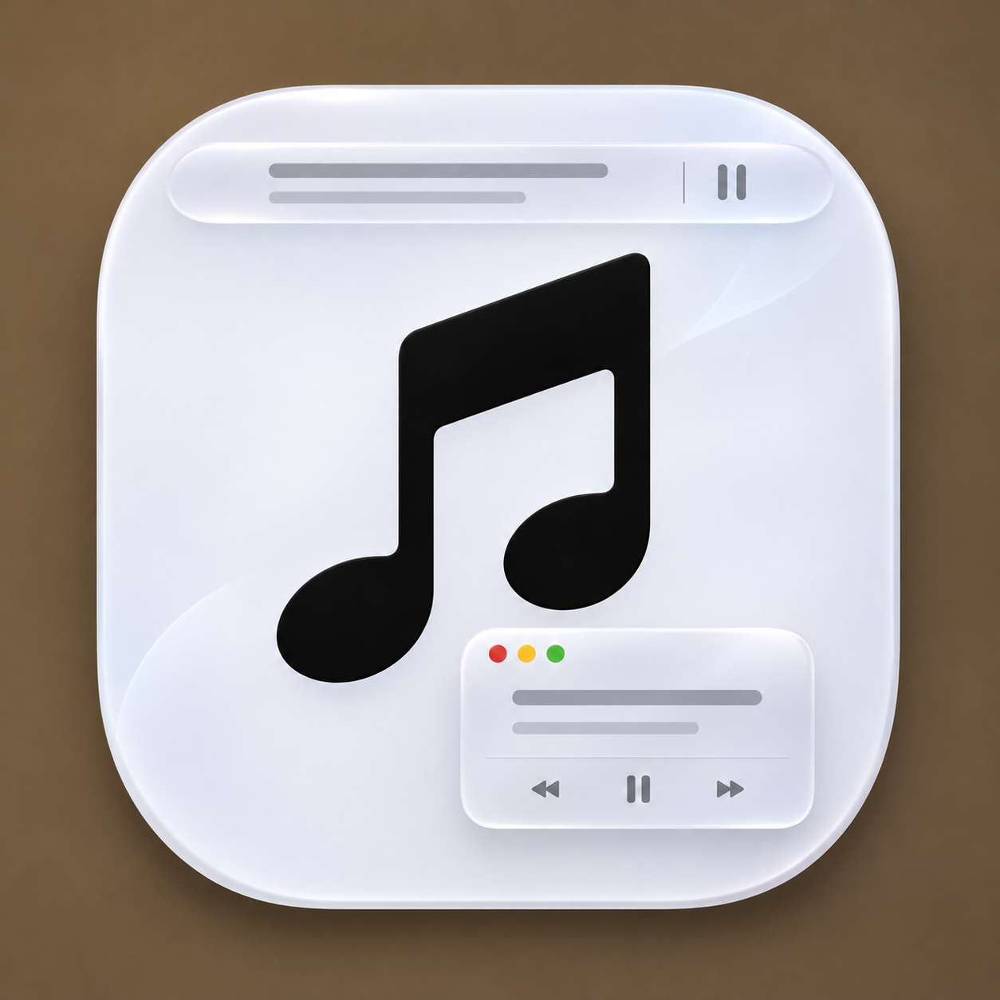

# Just-For-Music

[English](README.md) | 简体中文



面向 Apple Music 的 macOS 状态栏工具，提供同步歌词、播放控制和桌面歌词浮窗。[下载 Apple Silicon 安装包](https://github.com/dadelen/Just-For-Music/releases/latest) · [更新记录](CHANGELOG.md)

原有 Apple Music 缓存读取、TTML 解析和播放监测继续复用。此次改造围绕状态栏、系统玻璃浮窗、黑胶和歌词翻译展开。

## 功能

- 状态栏显示原文逐字歌词，上一首、播放／暂停、下一首各用独立的原生状态项。
- 状态栏提供「自动」和「仅图标」。自动模式根据屏幕选择歌词宽度，长歌词按演唱位置滚动，按钮位置固定。
- 打开桌面歌词时，状态栏歌词淡出，只显示三个播放键。按住 Option 点击播放键可打开播放器。关闭浮窗后恢复所选的状态栏模式。
- 点击状态栏歌词或图标可展开圆角播放器，查看专辑封面、歌名和作者，也可拖动进度条。底部的「歌词」「设置」「退出」分别打开桌面歌词、设置窗口和退出应用。
- 独立设置窗口分为桌面歌词、菜单栏、歌词效果、翻译、维护。
- 桌面浮窗使用系统玻璃。左侧是黑胶和金属唱针，右侧是原文、译文及可选缓存音译。
- 浮窗左上角的红、黄、绿点分别关闭浮窗、锁定位置和选择模式。黑胶模式解锁后可拖边缘或角落，在 640 × 260 pt 与 880 × 380 pt 之间缩放并记住尺寸。极简为 440 × 300 pt。
- 锁定时，浮窗左上角的三个按钮和黑胶播放键仍可点击，其余区域会把点击传给后方窗口。点击黄点解锁。
- 黑胶与真实封面每 12 拍旋转一圈，缺少 BPM 时每 6 秒一圈。点击唱针可播放或暂停。极简模式把歌名与歌手放在歌词上方，右侧显示播放控制。
- 前奏及有可靠边界的间奏/尾奏显示三点进度，随真实播放位置高亮。低于 1.5 秒或没有可靠结束时间的空档不生成进度。
- 歌词左对齐，当前句突出显示，邻句淡化。手动滚动停止 4 秒后回到当前播放行，译文通常为原文字号的 75%。
- 优先显示缓存中文译文。两种翻译模式都先读取歌词语种标注，缺少标注时在设备上识别。只有明确以外语为主的歌曲才启动自动翻译。
- 翻译按歌曲、源/目标语言、歌词版本及质量策略缓存，切歌隔离旧任务。翻译结果只出现在浮窗。
- 更新源指向本仓库的 GitHub Releases，安装镜像下载支持 SHA-256 校验。

已删除歌词导出、旧浮窗布局、Option 临时交互和全局快捷键。

## 兼容性

| 项目 | 条件 |
| --- | --- |
| CPU | 仅 Apple Silicon / arm64 |
| 最低运行系统 | macOS 13 |
| 玻璃 | macOS 26+：NSGlassEffectView；13–25：NSVisualEffectView |
| 机器翻译 | macOS 15+ 可用系统本地翻译；macOS 13+ 可配置联网翻译 |
| 自动翻译 | 默认关闭；默认翻译方式为系统本地，译文仅供参考 |
| 从源码构建 | Xcode 26.4+、macOS SDK 26.4+，Swift 6.3+ |

系统降低透明度时使用不透明系统背景；减少动态效果时停用黑胶旋转，保留歌词同步。

自动模式按屏幕条件选择歌词宽度，空间紧张时可切换到「仅图标」。状态项仍可能被系统隐藏，重新打开应用可进入设置。

## 歌词来源与限制

应用从以下 Music.app 本地缓存读取歌词：

```text
~/Library/Caches/com.apple.Music/Cache.db
~/Library/Caches/com.apple.Music/fsCachedData/
```

在 Music.app 播放 Apple Music 歌曲，并打开其歌词面板，让系统先缓存歌词。缓存按歌曲信息匹配；没有对应缓存时，应用会提示等待。导入的本地音乐、无歌词歌曲以及系统已清理的缓存不保证可用。该缓存格式由 Apple 私有实现控制，系统升级可能影响读取。

逐字精度取决于 TTML：多个字符共用一个 span 时，在该 span 时间范围内插值，不声称每个字符都有独立时间戳。语言识别对短句或模糊混合语言采用保守策略，可能跳过部分外语行。

## 构建、测试与运行

```bash
swift test
./scripts/package-app.sh
open "dist/Just-For-Music.app"
```

默认应用标识为 `io.github.dadelen.just-for-music`。

首次使用需要允许应用控制 Music。没有歌词时，先在 Music 打开歌词，再到「设置 → 维护」重新读取歌词缓存。本地翻译使用已安装的系统语言包。缺包时可在「系统设置 → 通用 → 语言与地区 → 翻译语言」下载，再到应用的「设置 → 翻译」重新检查。

也可在「设置 → 翻译」选择「联网大模型」，填写兼容 OpenAI 的 HTTPS 地址或本机 HTTP 地址。点击「获取模型」从返回的列表选择，服务不支持获取列表时可手动填写模型 ID。保存后可从列表切换当前 API，密钥存入 macOS 钥匙串。「测试连接」只发送固定示例句。确认歌曲以外语为主后，才将缺少中文译文的行发给当前服务，并要求模型跳过中文和中外文混合行。短歌词无法区分中文或日文时，保留原文，不发送请求。联网失败或漏译时，macOS 15 或更新版本可用系统翻译补齐。

本地包使用 ad-hoc 签名，未做 Developer ID 公证。对外分发应配置自己的签名身份和公证流程。

## 打包与自有更新源

```bash
VERSION=1.0.1 BUILD_NUMBER=4 ./scripts/create-release-artifacts.sh
```

生成 arm64 ZIP、DMG 和 `SHA256SUMS.txt` 到 `dist/release/`。包内保留 MIT License。

二次开发时，可为自己的构建替换应用标识和更新仓库。

```bash
BUNDLE_IDENTIFIER=com.yourname.lyrics \
UPDATE_REPOSITORY=yourname/your-repository \
VERSION=1.0.1 BUILD_NUMBER=4 ./scripts/create-release-artifacts.sh
```

`v1.0` 提供源码归档。后续可用三段版本号标签触发安装包构建，工作流使用所在仓库作为更新源。

## 验收与诊断

「设置 → 维护」支持查看、复制和定位日志。日志含歌曲元数据和错误信息，分享前请自行检查。

详细实现状态、测试记录、文件清单及人工验收项见 [开发交付报告](docs/DEVELOPMENT_REPORT.md)。
产品规格见 [V2.1 需求文档](docs/REQUIREMENTS_V2.md)，开发约束见 [CONTRIBUTING.md](CONTRIBUTING.md)。

## 原项目署名与声明

Just-For-Music 由 [dadelen](https://github.com/dadelen) 维护，基于 [Takpap/apple-music-lyrics](https://github.com/Takpap/apple-music-lyrics) 开发。感谢 Takpap 和原项目贡献者，仓库保留原始版权声明及 [MIT License](LICENSE)。

本项目独立开发，与 Apple 无隶属、赞助或背书关系。Apple、Apple Music 和 macOS 是 Apple Inc. 的商标。歌词、专辑封面等内容的权利归各自权利人，本项目的 MIT 许可适用于软件代码。
